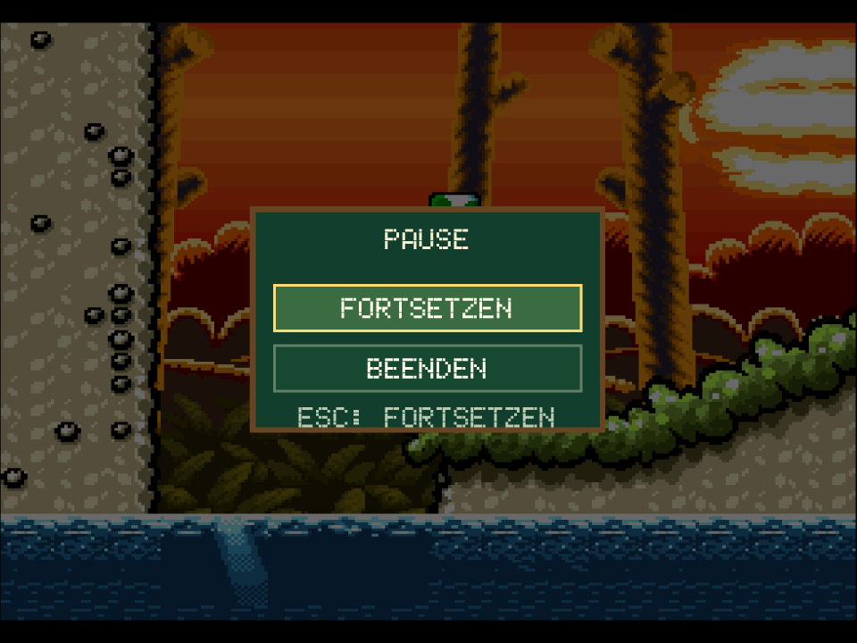
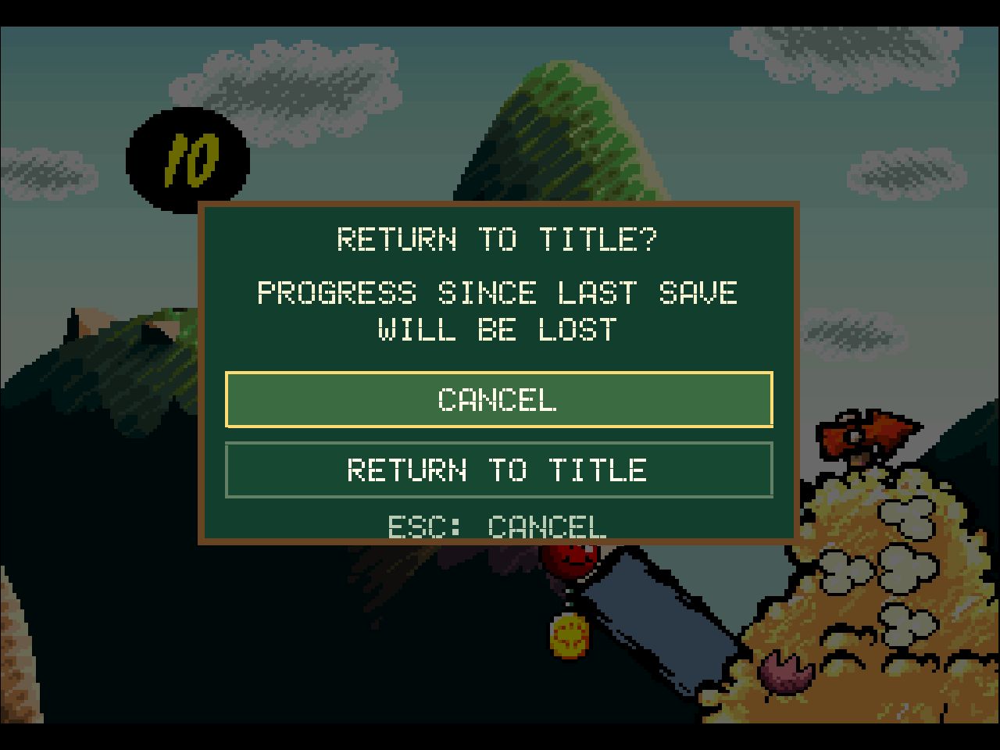
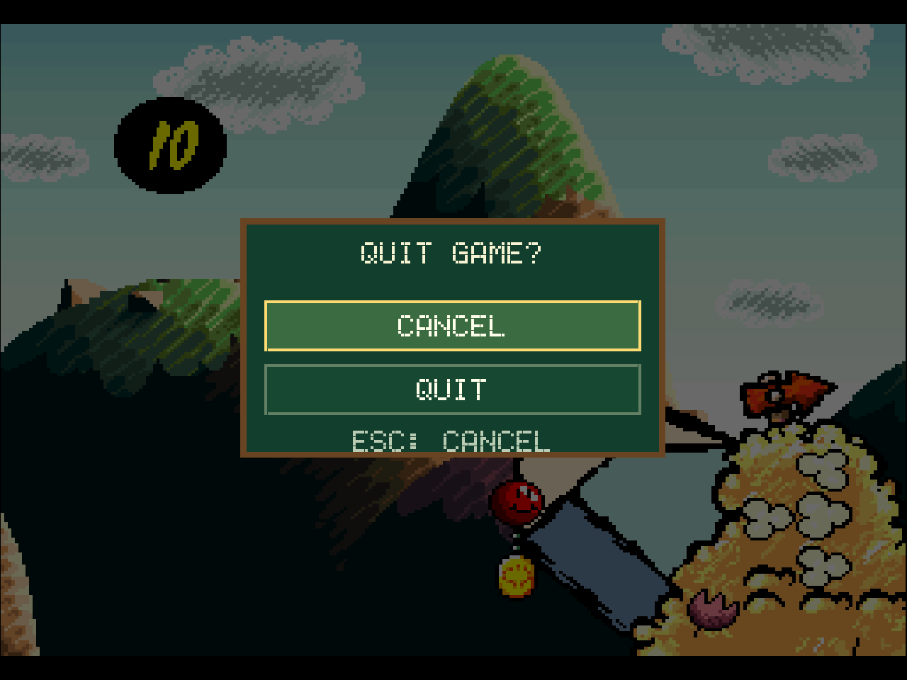

# Host pause menu

Esc opens **Continue** (selected by default), **Return to title**, and **Quit**. Esc again resumes. Both Return to title and Quit require confirmation, with **Cancel** selected by default. Window-close requests use the Quit confirmation. Return to title warns that progress since the last save is lost.

Return to title restarts the same ROM on Windows, bypassing the launcher and loading the last persisted game save without an additional exit save write. Preparation failures keep the current game open. See [restart behavior](RETURN_TO_TITLE.md).

Keyboard: arrows, Enter/Space, Esc. Mouse: hover/click. Controller: D-pad, A to select and B/Start to return. Resume waits for menu action buttons to be released before forwarding gameplay input.

Guest execution and audio pause while the overlay is open. Resume resets host frame pacing so menu time does not produce catch-up frames. Normal Quit retains its existing SRAM persistence. No manual save, settings or save-state action is added.

The SDL overlay restores renderer colour/blend state and does not change logical aspect, filtering, game pixels, camera or enemy activation. It has no widescreen or RetroAchievements dependency.

`pause_menu_contract` uses a synthetic SDL software surface, without a ROM or game execution. It checks safe defaults, repeat rejection, confirmation/cancel, release gating, keyboard/mouse/controller input and renderer-state preservation at native and wide logical sizes.

## Size previews

These show the actual overlay renderer over an F9 game capture, at the normal
4:3 presentation size. They are rendered previews, not live menu screenshots.

