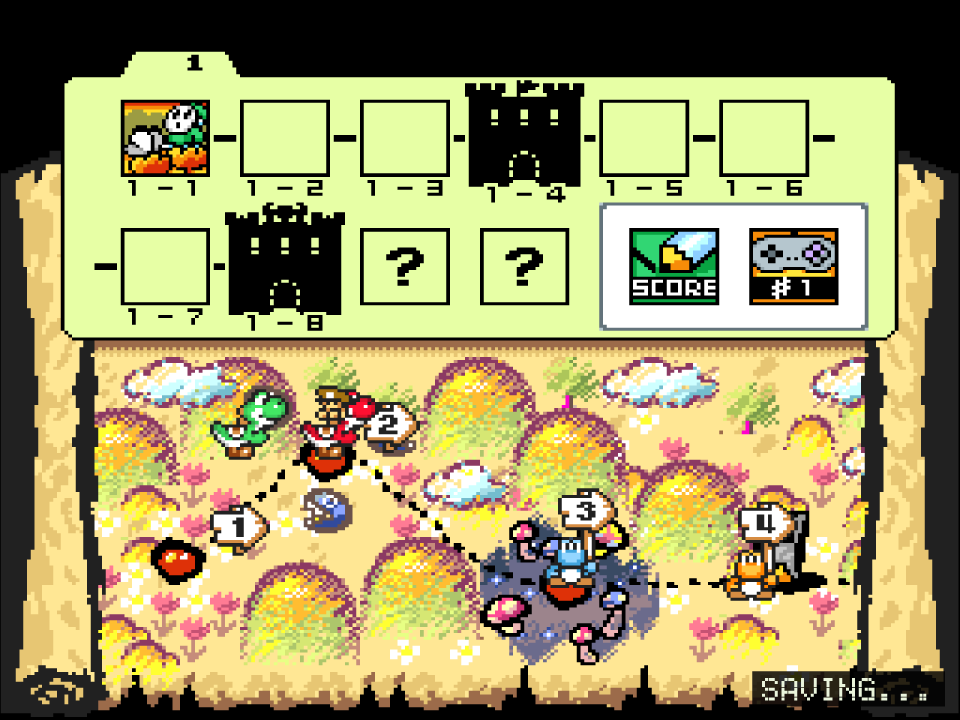

# SRAM write indicator

A small **SAVING...** badge appears for 1.4 seconds after a successful file write containing changed permanent game-save data. Unchanged periodic writes and volatile GSU graphics/work RAM do not trigger it. **SAVE ERROR** appears for five seconds if opening, writing or closing the save file fails, or no valid native primary/backup exists for a slot; the successful baseline is not advanced on failure.

The original game controls what becomes persistent SRAM: level results/progression and overworld/bonus updates are examples. This is not a save state and does not make a mid-level checkpoint survive restarting the program.

The existing desktop schedule remains unchanged: write SRAM every 300 game frames (about five seconds NTSC or six seconds PAL at normal speed) and on a normal exit. The badge reports completed writes; it may briefly remain visible after the short synchronous write has finished. For a gameplay check, complete a new stage or improve its score, return to the map and wait for the next periodic write.

Native save data is read from SRAM0x7C00..0x7E7B. For each of the three slots, validate the original checksum and compare the valid primary payload, falling back to its valid backup. A temporary invalid primary and its later restoration are not new saved progress. If neither copy is valid, report an error without advancing the successful baseline. Source memory is read only. The SDL overlay restores renderer state and has no pause-menu, filter, RA or widescreen dependency.

`save_indicator_contract` checks unchanged/volatile-only writes, permanent changes, failures, retries, expiry, valid backup fallback, suppression of primary-restoration duplicates, source preservation and rendering state at native/wide logical sizes using a synthetic surface. No game ROM or account is required.

The notification appears after the synchronous write and close complete; waiting
for the badge to disappear is unnecessary. Reaching the goal alone is not a disk
write confirmation. Allow the score/result sequence to finish; returning to the
world map and waiting for the indicator is a practical test. A successful badge
only confirms game-save data already committed by the guest, not a mid-level state.

## Size preview

Actual indicator renderer over an F9 world-map capture. This is a rendered preview,
not a live screenshot proving that a write occurred at the captured instant.

