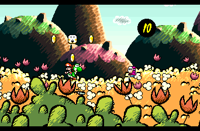
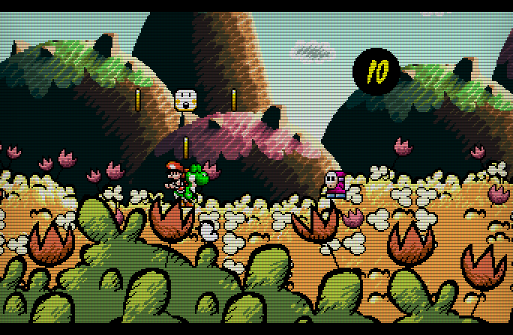
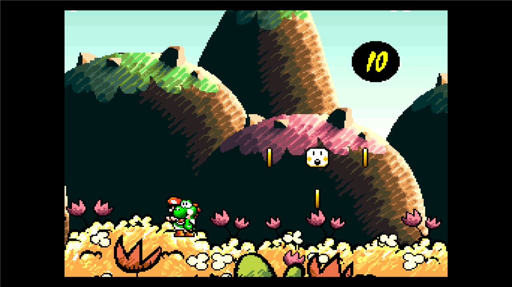

# Windows Release gameplay and performance evidence

Tested by the contributor on 19 November 2026, Windows, Intel Core i7-13700KF,
Direct3D, VSync requested **on** and successfully applied. Gameplay evidence is
from the separate **combined integration build**, Europe Rev 2, level 1-1.
This filter PR does **not** add European ROM support, RetroAchievements or
widescreen; those features remain separate. The standalone filter build and
combined build use the same filter implementation.

The contributor verified cycling through all five modes, rebinding F7 to **F2**,
and persistence after restarting. Normal SRAM load/save was logged. No further
playthrough is required for this filter review.

## Same-frame before/after images

Each row uses the Original and selected filter from **the same F9 frame**.
PNG copies retain every RGB byte; unused alpha is made opaque. These are raw
SNES buffers: 342x224 before, 1026x672 after. Their raw pixel geometry is not
the final display aspect. The screenshots intentionally contain game imagery,
not ROM files, credentials, saves, account overlays or personal desktop content.
Game imagery remains the property of its respective rights holders.

| Mode | Original | Filter |
|---|---|---|
| Sharp |  |  |
| Scanlines |  |  |
| CRT |  |  |
| LCD grid |  |  |

The final native-width Sharp capture below includes the actual centered 4:3
presentation with side borders (whole output resized from3840x2160 to1280x720,
without cropping). It is from the final separate native-width session.

## Live measurements

Wide input342x224, PAL target50.007 FPS, output3840x2160. Each sample spans
approximately five seconds. Conservatively exclude the first logged performance
interval after each F9 capture: BMP I/O can lower FPS and increase CPU. All raw
interval numbers, including exclusions, are retained in
[live-wide-intervals.csv](display-filters/live-wide-intervals.csv).

| Mode | Clean intervals | Median FPS | Filter ms/frame | Whole-process CPU, % of one core |
|---|---:|---:|---:|---:|
| Sharp | 4 |50.010 |0.3489 |31.76 |
| Scanlines |2 |50.007 |0.3519 |36.74 |
| CRT |1 |50.015 |0.4693 |40.16 |
| LCD grid |1 |50.009 |0.3505 |41.40 |

No sustained FPS reduction is visible in these limited clean samples under
VSync. CRT/LCD each have only one clean interval; these are not worst-case or
uncapped benchmarks. The only Original interval includes F9 I/O, so it is **not**
used as a clean baseline. Positions and object activity differ between modes:
whole-process CPU differences must **not** be attributed entirely to filtering.
100% here means one full logical CPU core, not the whole24-thread machine.

The final stationary/native-width session records six Sharp intervals, median
50.007 FPS, approximately0.264 ms filter time per frame. Only Sharp is recorded
in that session; the contributor's cycling/persistence confirmation and earlier
all-mode screenshots provide the other functional evidence. See
[live-native-excerpts.txt](display-filters/live-native-excerpts.txt).

## Measurable 3x processing cost

An isolated Release/O3 benchmark executes the unchanged production
`YiEffectApply` on real captured1-1 pixels, without running emulation. Five
rotating-order batches per filter/width, each100 warm-up then1000 measured
frames. SDL performance counter measures elapsed time; Windows GetProcessTimes
measures process CPU. Median elapsed time per frame:

| Filter |256x224 |342x224 |
|---|---:|---:|
| Sharp |0.2614 ms |0.3491 ms |
| Scanlines |0.2599 ms |0.3484 ms |
| CRT |0.3501 ms |0.4757 ms |
| LCD grid |0.2611 ms |0.3505 ms |

Measured kernel CPU time projects to approximately1.25–2.27% of one core at50 FPS.
This projection covers **only the filter kernel**, excluding larger texture
uploads, SDL/GPU presentation and emulation. Original skips the3x routine;
no artificial copy loop is presented as the Original implementation. Raw batches:
[kernel-benchmark.csv](display-filters/kernel-benchmark.csv).

## VSync, integration and limits

The branch includes main1922348 (merged VSync#8). Neither filtering nor diagnostics
force VSync off or change regional pacing. Local Release checks: nine standalone
filter contracts and16 combined contracts passed, including key persistence,
callback registration, filtering, F9 readback and presentation.

The launcher helper now accumulates and deduplicates callbacks per target rather
than replacing earlier panels. Six registration orders and separate targets
were tested locally. In the combined build, the pipeline is selected native/wide
source -> optional3x filter -> aspect-correct destination -> RA overlay last.
Native/wide image contracts and actual wide/native filter captures validate that
ordering. RA website awards are outside this filter claim; PAL RA remains gated.

The original standalone presenter assumes256x224. Merging#5/#7 must retain the
combined source-selection/presentation ordering and use the shared helper
version: a textual merge alone is not sufficient. This PR does not silently
bundle those features or claim every boss/effect is widescreen-compatible.

F9 now reads an explicit full-output rectangle into initialized opaque borders,
fixing viewport readback displacement without changing game rendering. The
production-helper regression covers horizontal/vertical letterboxes, matching
aspect,2x scaling and unchanged renderer state; restoring the old NULL rectangle
makes the regression fail. No camera/enemy activation changes are included.
