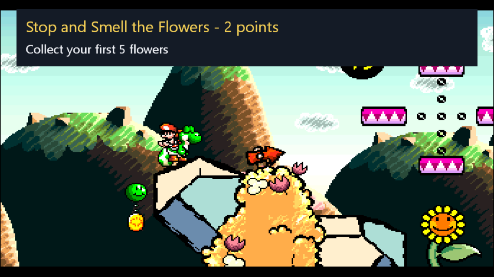
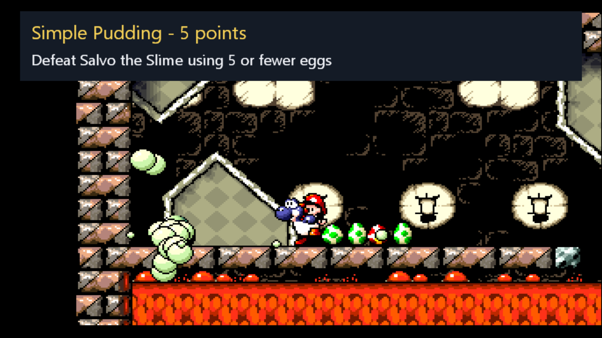

# RetroAchievements validation

Windows Release, 19 November 2026. Supported USA ROM, online Softcore only.
Real-account tests were performed by the contributor; automated HTTP tests use mocks.

## Requested live flow

| Requirement | Evidence |
|---|---|
| Sign-in and session restore | Password logins and restored-token sessions logged; game 558, 63 achievements |
| Legitimate unlock and notification | Five distinct server-accepted IDs: 1300, 186901, 186926, 1305, 5962; matching popup captures below |
| Website visibility | Contributor confirms legitimate unlocks appeared on the website |
| Logout and restart | Successful secure-session deletion logged; contributor confirms restart stays signed out |
| Offline/reconnect | Contributor observed a failed offline login and successful retry in the same launcher after reconnecting; successful retry is logged |
| Shutdown | Normal cancellation/join logged; blocked-request cancellation covered by mocks |

[Sanitized live logs](retroachievements/live-session-excerpts.txt).
The old build did not log the failed offline attempt. Offline-award retry is
mock-tested, not live-verified. Pending awards do not survive process exit.

## Server-confirmed notifications

These current review captures demonstrate RA notifications, not widescreen coverage.

[Metadata](retroachievements/capture-64338756241.json): HTTP 200, achievement 1300.

[Metadata](retroachievements/capture-88953806540.json): HTTP 200, achievement 186926.

## Preferences and lifecycle

- `save_preferences()` changes only `[Mods] RetroAchievements`. Tests cover unrelated
  sections/keys/comments, BOM/CRLF, duplicate/missing keys and write failures.
- Only the owner thread accesses rc_client and guest RAM. The worker performs I/O;
  shutdown cancels WinHTTP and joins it before destroying the client. Generation
  guards prevent stale media/account responses affecting the current session.
- Passwords are not persisted. Tokens use Credential Manager or current-user DPAPI.
  Logout deletes both stores and reports deletion failures; disabling RA retains login.
- HTTPS uses official-host/port allowlisting, normal certificate validation, no
  redirects, finite timeouts and a 4 MiB response limit.
- Mock regressions cover rejected login, restore/logout, secure-store failures,
  pending-award retry/deduplication, late responses and blocked-request shutdown.

## Dependency provenance

rcheevos 12.5.0, commit
[`1433173220a7eaede6a9ed7a18e94117be1821e0`](https://github.com/RetroAchievements/rcheevos/tree/1433173220a7eaede6a9ed7a18e94117be1821e0).
65 upstream Git blobs match. Only `src/rc_client.c` differs: two logout/unload
mastery guards. [Exact patch](retroachievements/rcheevos-local.patch).
MIT and third-party notices are retained; details: `vendor/rcheevos/UPSTREAM.json`.

## Build and integration

Updated onto main 1922348 (#4/#8). Windows Release CI passes all 11 ROM-free
contracts. Two additional local ROM-reading/mock-client tests passed.
[Local results](retroachievements/local-test-results.json).

The shared launcher helper accumulates/deduplicates callbacks per target; six
registration orders and target isolation are tested. The combined integration
was validated separately: native/wide source -> optional filter -> aspect-correct
presentation -> RA overlay. Merging #5/#6/#7 must preserve that ordering.
PAL, filter and widescreen implementations are outside this PR; EU RA is blocked.
Maintainer integration/security review remains pending.
