# Experimental widescreen: review evidence and remaining checks

19 November 2026. Main 1922348 includes audio#4 and VSync#8. Widescreen remains
**off by default and experimental**. No complete-game/boss/Mode7/PAL guarantee.
No camera or enemy activation expansion was added during this follow-up.

## Evidence now available

The contributor reports USA progress through **1-8**, extending the old1-6
report. Logs show stage6/7 activity; this does not prove every intermediate room.
Current audited groups:38 USA +13 Europe Rev2. Of these,20 USA +12 PAL have
actual active-wide frames; **all 32 preserve the complete native center RGB exactly**.
Inactive wide buffers are excluded from this claim. Raw audit:
[capture-audit.json](widescreen/capture-audit.json).

Representative PAL evidence now exists: Rev2 level 1-1, native and wide outputs,
all display filters, VSync on and~50 FPS. Other PAL levels/special scenes remain
unverified. Filter and RA evidence is documented separately in#6/#5.

## Same-frame native/wide pairs

These 11 pairs are real F9 captures, native 256x224 and wide 342x224. Each pair is
from one emulated frame. Raw SNES pixel geometry differs from final display
aspect; the unchanged center and added side pixels are the purpose of these
comparisons. PNG conversion normalizes only unused alpha; every RGB byte is
checked against the original BMP. Game imagery belongs to its rights holders.

| Scene / capture | Native | Wide |
|---|---|---|
| Tutorial introduction · 62197429519 | 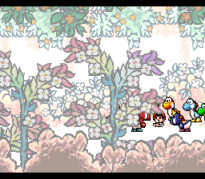 | 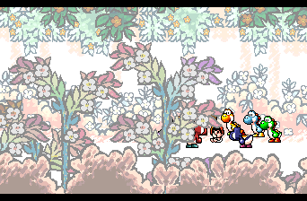 |
| Tutorial dialog · 62323879214 |  |  |
| Tutorial bridge · 63000362422 | 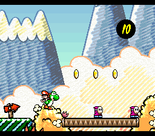 | 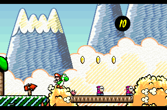 |
| 1-1 cave entrance · 63490594791 | 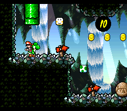 |  |
| 1-1 cave · 63579043023 | 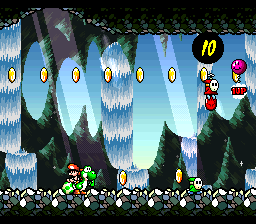 |  |
| 1-1 flowers/platforms · 64338756241 | 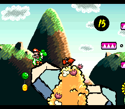 |  |
| 1-1 goal · 64566724821 | 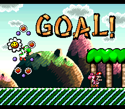 | 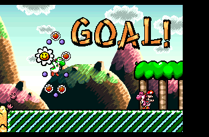 |
| 1-5 autoscroller overview · 65833035412 |  | 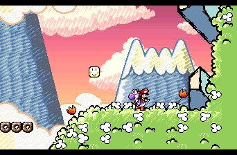 |
| 1-5 autoscroller platforms · 65909039735 |  | 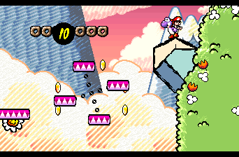 |
| 1-8 Salvo AFTER defeat · 88953806540 |  |  |
| Europe Rev2 1-1, combined CRT/VSync-on test · 102895842357 | 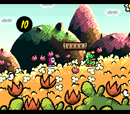 |  |

## Autoscroller edge reach: different times, explicitly labelled

The contributor requested separate-time comparisons where necessary. These
images show Yoshi at the **left** boundary (partially clipped), not his complete
travel path. Camera position/platforms differ: no pixel-identical scene claim.
They do not demonstrate the right edge or push/crush behavior.

| Original view66004820488 | Wide65962696005 |
|---|---|
|  | 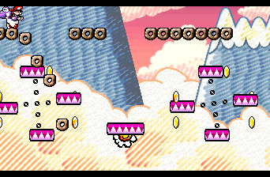 |

## Boss comparison: post-defeat only

Original88942096379 and wide88953806540 share logged camera416/1804 but differ
in time and moving particles. The large active Salvo deformation is **not** shown.
The wide frame has black extra columns on the left and scenery on the right;
this limitation is retained, not painted over or called full bilateral coverage.

| Original, different frame | Wide, post-defeat |
|---|---|
| 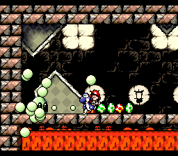 |  |

## Existing bonus fallback

Capture64794242507 is a genuine bonus Scratch board with `presentation_wide=0`.
The preceding log explicitly re-enables widescreen and reports gate004
(game-mode fallback) before the capture. Only its native buffer is shown; inactive `wide.bmp` is not presented as a wide
frame. This closes the bonus fallback screenshot gap; it is not proof of a
narrow terrain room or a Mode7 scene.

## What changes, what remains native

- `src/yi_ws11.c`: `YiWs11WorldTile`/`fill_world_span` reconstruct actual ROM/Map16
  scenery outside the native viewport; private PPU/OAM passes do not overwrite
  native center pixels. This does not synthesize extra guest objects.
- `reject_mask`, `native_autoscroll_view` and room/profile/tile guards decide
  eligibility. Unknown layouts/anchors, bounded narrow terrain, bonus gameplay,
  unsupported forms/states and invalid tiles retain native output. Some known
  UI/Mode7 and bitmap-arena paths exist; this is not blanket effect support.
- Enemy/object spawn/despawn and camera remain original. Eggs, projectiles,
  particles and interactive sprites appear in side regions only if already
  generated by the game. Native-boundary pop-in/pop-out is an intentional
  limitation. Unexpected invisible hazards/collision still need reporting.
- **Explicit existing gameplay exception:** `player_edge_operand` alters two
  verified SuperFX immediate operands in active supported autoscrollers, moving
  player limits by 43 pixels per side. The original push/speed/subpixel/Baby Mario/
  crush routines consume those shifted bounds. Thus this feature is not purely
  output-only even though camera, activation and ROM bytes remain unchanged.
- Exact ROM/profile and instruction anchors guard the hook. F8/native disables
  the override; unrelated instructions/warp thresholds retain original operands.
  Unknown edge code forces native autoscroll geometry. Hook fields are host-only,
  not serialized guest state. Contracts check operands, state preservation,
  fallback, native-mode restoration and invalid anchors, not real collision play.
- A narrow room may correctly fall back to4:3. Transitions can preserve wide
  geometry with native-only content rather than inventing terrain; inspect for
  stale edge pixels, corruption or bad masks. F9 alone does not prove no flicker.

## Technical follow-up and integration

F9 now uses the identical full-output readback helper from#6/#5: explicit output
rectangle, initialized borders, opaque alpha, unchanged renderer settings.
A uniquely named `ws_capture_contract` avoids target clashes with those PRs.
Old native present screenshots with the viewport-offset bug are **not** used to
judge game centering. Raw buffers remain valid. The later native PAL capture
105317852361 already documents corrected 4:3 centering in#6.

Shared launcher helper: accumulate/deduplicate callbacks per target, with six
registration orders and target isolation checked. It matches#5/#6. The combined
pipeline is native/wide source selection -> optional3x filtering -> correct
presentation rectangle -> RA overlay last. Ordinary PAL/native/wide filter and
USA notification captures exist. A textual merge must preserve that ordering;
this standalone PR does not include RA or filter implementations.

Local Release: 8 registered ROM-free contracts passed, including USA/PAL
widescreen (1847 assertions each), renderer readback, main VSync and launcher
coexistence. Four real ROM layout-only checks passed without game execution.
[Local results](widescreen/local-test-results.json). Hosted Windows CI is checked
separately; it runs only ROM-free contracts, never supplied ROMs or live gameplay.

## Coverage limits

Only the current review captures above are presented as visual evidence.
Older screenshots submitted to report bugs are excluded, including pre-fix
boss, vertical-scrolling, transition and narrow-room images. They do not
represent the current native black top/bottom bands.

The contributor confirms right-edge autoscroll crush/death in both 4:3 and
16:9. This is an owner-observed gameplay result, not a frame-by-frame audit.
Mode7 execution is recorded in runtime logs, but a matched visual pair is
not available. Current-build active boss deformation (including Salvo),
further PAL special scenes and all transitions remain incompletely verified.
The feature stays experimental and off by default pending maintainer review.
