# Experimental widescreen: review evidence and remaining checks

19 November 2026. Main 1922348 includes audio#4 and VSync#8. Widescreen remains
**off by default and experimental**. No complete-game/boss/Mode7/PAL guarantee.
No camera or enemy activation expansion was added during this follow-up.

## Evidence now available

The contributor reports USA progress through **1-8**, extending the old1-6
report. Logs show stage6/7 activity; this does not prove every intermediate room.
Current audited groups:38 USA +13 Europe Rev2. Of these,20 USA +12 PAL have
actual active-wide frames; **all 32 preserve the complete native center RGB exactly**.
Inactive wide buffers are excluded from this claim. Raw audit:
[capture-audit.json](widescreen/capture-audit.json).

Representative PAL evidence now exists: Rev2 level 1-1, native and wide outputs,
all display filters, VSync on and~50 FPS. Other PAL levels/special scenes remain
unverified. Filter and RA evidence is documented separately in#6/#5.

## Same-frame native/wide pairs

These 11 pairs are real F9 captures, native 256x224 and wide 342x224. Each pair is
from one emulated frame. Raw SNES pixel geometry differs from final display
aspect; the unchanged center and added side pixels are the purpose of these
comparisons. PNG conversion normalizes only unused alpha; every RGB byte is
checked against the original BMP. Game imagery belongs to its rights holders.

| Scene / capture | Native | Wide |
|---|---|---|
| Tutorial introduction · 62197429519 |  |  |
| Tutorial dialog · 62323879214 | 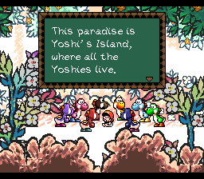 | 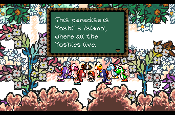 |
| Tutorial bridge · 63000362422 |  |  |
| 1-1 cave entrance · 63490594791 |  | 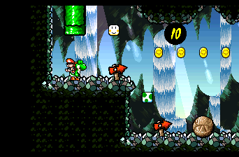 |
| 1-1 cave · 63579043023 |  | 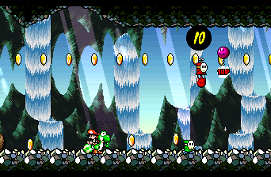 |
| 1-1 flowers/platforms · 64338756241 |  | 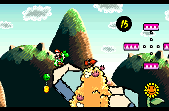 |
| 1-1 goal · 64566724821 |  |  |
| 1-5 autoscroller overview · 65833035412 | 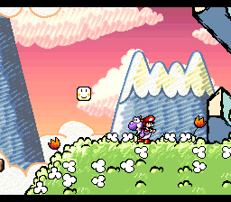 |  |
| 1-5 autoscroller platforms · 65909039735 | 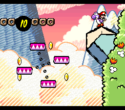 |  |
| 1-8 Salvo AFTER defeat · 88953806540 | 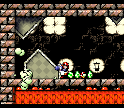 | 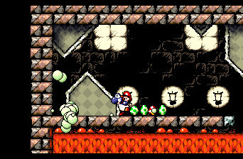 |
| Europe Rev2 1-1, combined CRT/VSync-on test · 102895842357 |  | 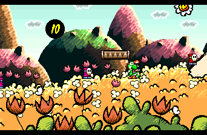 |

## Autoscroller edge reach: different times, explicitly labelled

The contributor requested separate-time comparisons where necessary. These
images show Yoshi at the **left** boundary (partially clipped), not his complete
travel path. Camera position/platforms differ: no pixel-identical scene claim.
They do not demonstrate the right edge or push/crush behavior.

| Original view66004820488 | Wide65962696005 |
|---|---|
| 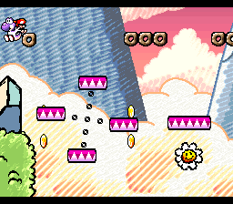 |  |

## Boss comparison: post-defeat only

Original88942096379 and wide88953806540 share logged camera416/1804 but differ
in time and moving particles. The large active Salvo deformation is **not** shown.
The wide frame has black extra columns on the left and scenery on the right;
this limitation is retained, not painted over or called full bilateral coverage.

| Original, different frame | Wide, post-defeat |
|---|---|
|  |  |

## Existing bonus fallback

Capture64794242507 is a genuine bonus Scratch board with `presentation_wide=0`.
The preceding log explicitly re-enables widescreen and reports gate004
(game-mode fallback) before the capture. Only its native buffer is shown; inactive `wide.bmp` is not presented as a wide
frame. This closes the bonus fallback screenshot gap; it is not proof of a
narrow terrain room or a Mode7 scene.

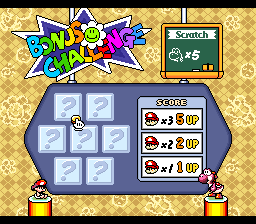

## What changes, what remains native

- `src/yi_ws11.c`: `YiWs11WorldTile`/`fill_world_span` reconstruct actual ROM/Map16
  scenery outside the native viewport; private PPU/OAM passes do not overwrite
  native center pixels. This does not synthesize extra guest objects.
- `reject_mask`, `native_autoscroll_view` and room/profile/tile guards decide
  eligibility. Unknown layouts/anchors, bounded narrow terrain, bonus gameplay,
  unsupported forms/states and invalid tiles retain native output. Some known
  UI/Mode7 and bitmap-arena paths exist; this is not blanket effect support.
- Enemy/object spawn/despawn and camera remain original. Eggs, projectiles,
  particles and interactive sprites appear in side regions only if already
  generated by the game. Native-boundary pop-in/pop-out is an intentional
  limitation. Unexpected invisible hazards/collision still need reporting.
- **Explicit existing gameplay exception:** `player_edge_operand` alters two
  verified SuperFX immediate operands in active supported autoscrollers, moving
  player limits by 43 pixels per side. The original push/speed/subpixel/Baby Mario/
  crush routines consume those shifted bounds. Thus this feature is not purely
  output-only even though camera, activation and ROM bytes remain unchanged.
- Exact ROM/profile and instruction anchors guard the hook. F8/native disables
  the override; unrelated instructions/warp thresholds retain original operands.
  Unknown edge code forces native autoscroll geometry. Hook fields are host-only,
  not serialized guest state. Contracts check operands, state preservation,
  fallback, native-mode restoration and invalid anchors, not real collision play.
- A narrow room may correctly fall back to4:3. Transitions can preserve wide
  geometry with native-only content rather than inventing terrain; inspect for
  stale edge pixels, corruption or bad masks. F9 alone does not prove no flicker.

## Technical follow-up and integration

F9 now uses the identical full-output readback helper from#6/#5: explicit output
rectangle, initialized borders, opaque alpha, unchanged renderer settings.
A uniquely named `ws_capture_contract` avoids target clashes with those PRs.
Old native present screenshots with the viewport-offset bug are **not** used to
judge game centering. Raw buffers remain valid. The later native PAL capture
105317852361 already documents corrected 4:3 centering in#6.

Shared launcher helper: accumulate/deduplicate callbacks per target, with six
registration orders and target isolation checked. It matches#5/#6. The combined
pipeline is native/wide source selection -> optional3x filtering -> correct
presentation rectangle -> RA overlay last. Ordinary PAL/native/wide filter and
USA notification captures exist. A textual merge must preserve that ordering;
this standalone PR does not include RA or filter implementations.

Local Release: 8 registered ROM-free contracts passed, including USA/PAL
widescreen (1847 assertions each), renderer readback, main VSync and launcher
coexistence. Four real ROM layout-only checks passed without game execution.
[Local results](widescreen/local-test-results.json). Hosted Windows CI is checked
separately; it runs only ROM-free contracts, never supplied ROMs or live gameplay.

## Follow-up correction: evidence that was already present

The earlier gap list was too broad: it omitted older user captures and real
Mode7/bounded-room log records. Do not ask the contributor to repeat those tests
simply because they were not initially indexed.

### Narrow room: the requested F9 image exists

Capture **544885770966** shows the small room with the green pipe. The r13 log
identifies stage2 (1-3), room02, camera0/1804. The contributor remembered it as
approximately1-2; the capture, rather than that approximate level number, is the
reference. The raw native screenshot below is the actual user capture.

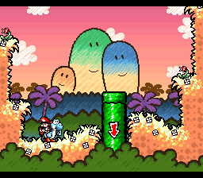

Important chronology: the r13 capture was made **before** the bounded-room fix;
it reported wide=1. The later r14 live log for the same room explicitly records
`native fallback`, `gate=800 reasons=bounded-room`, zero extra side widths, and
widescreen enabled. The latest combined review also logs bounded-room fallback
in stage6/room06. Thus real narrow-room execution/fallback evidence exists.
Do not relabel the old photo as a new-build post-fix capture, or a diagnostic
replay image as live gameplay. No repeated narrow-room test is requested.

### Genuine Mode7 is already in live logs

For example, the latest USA review session records `PPU=07`, gameplay mode0a,
`16:9`, gate000 and `Centered UI / wide background`. Actual Mode7 execution is
therefore present in current runtime evidence, not only synthetic contracts.
PAL sessions also contain `PPU=07` with explicit native fallback during map/UI
transitions. This does not prove all Mode7 scenes visually perfect.

No actual F9 photo among the audited images is matched to that Mode7 interval.
The remaining gap is a **paired visual capture**, not an untested runtime path.
Also, `levelMode=7` in the fortress is an unrelated level-layout value: its
`PPU=69` means hardware background mode1, and is not counted as Mode7 proof.

### Right-edge push/crush: owner-confirmed, both views

On19 November2026 the contributor explicitly confirmed that they let Yoshi be
crushed at the **right** autoscroll edge and die in **both4:3 and16:9**.
Record this as a real owner-observed gameplay test, not a mock test and not a
video/frame-by-frame audit. The older left-edge photographs remain separate.
The requested practical right-edge/crush comparison is completed; no repeat
crush/death or new playthrough is requested merely to create another screenshot.

### Active boss, vertical scrolling and transition images also exist

The r14 user images below supplement the newer evidence. They are labelled
historical, not current-binary acceptance. At the time, vertical expansion also
filled the top8 formerly blank rows; RGB differences against native are confined
to those rows, with rows8–223 matching exactly. The newer32/32 center-preservation
claim above is unchanged and applies only to the newer capture set.
[Measured historical differences](widescreen/historical-pair-checks.json).

| Existing test | Native | Wide |
|---|---|---|
| Active large Burt,1-4 ·560228934263 | 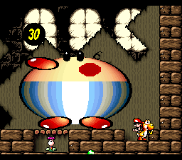 | 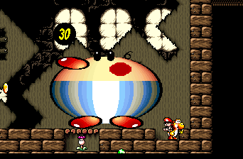 |
|1-4 lower area ·557355499776, camera0/1804 | 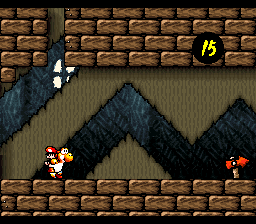 | 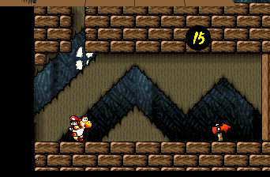 |
| Same fortress room, upper area ·558600790835, camera1350/1036 | 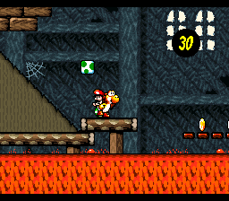 | 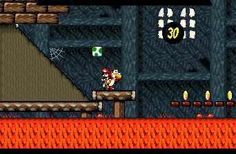 |
|1-2 closing/iris transition ·552641290214, mode10 | 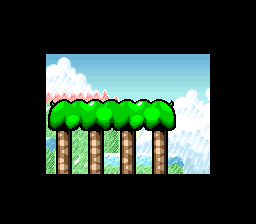 | 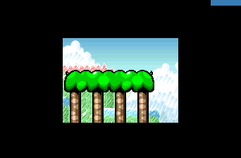 |

These are genuine F9 images, not recreated scenes. Different camera positions
and a visible closing mask provide existing representative scrolling/transition
evidence; they are not a guarantee that every door/pipe/fade is correct.
An active boss scene is already pictured (Burt). **Active Salvo** is still not
pictured; the newer Salvo frames remain post-defeat only. That is a specific
coverage limitation, not absence of any active-boss testing.

## What really remains

- For a complete visual Mode7 set, one F9 capture while the actual Mode7/title/
  island view is visible is still missing. No full replay; the log identifies
  the state. If not supplied, retain the visual limitation explicitly.
- Active Salvo, further PAL special scenes and every possible transition are
  not fully verified. Keep those as scope limits of this experimental feature,
  not a new mandatory whole-game checklist. Existing representative cases above
  are not erased simply because a newer test package exists.
- Maintainer integration/security/rendering review and any newly observed
  regression remain open. No claim of complete-game or all-boss compatibility.

[Sanitized exact narrow/Mode7/boss/scroll/transition log contexts](widescreen/narrow-mode7-historical-excerpts.txt)
accompany this correction. Right-edge crush is clearly attributed to the
contributor's live report; it is not fabricated from those unrelated logs.
