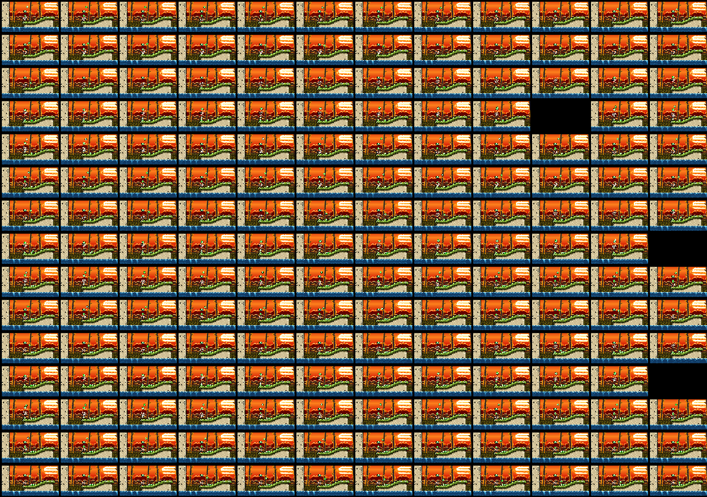
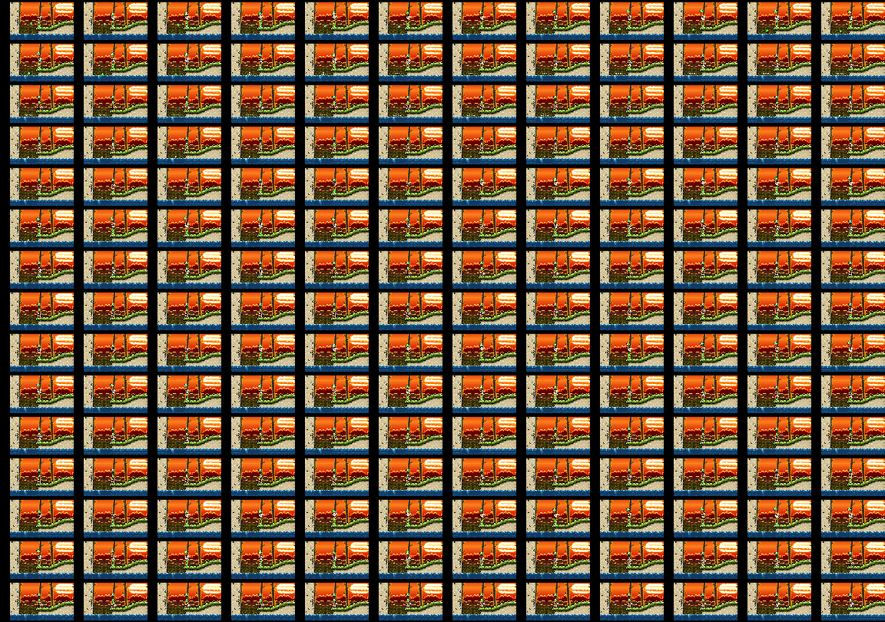

# Experimental widescreen: fixes and validation

Widescreen is opt-in and **off by default**. The contributor reports **no visible issues through USA stage 2-8 inclusive** after these fixes. This is a gameplay report, not full-game or all-region certification.

## Latest fixes

- **Room edges:** the allocated terrain map supplies shared room bounds. Narrow rooms and bonus gameplay retain native 4:3; unallocated side areas remain black rather than exposing coloured strips. Pause/results keep their UI in the native centre.
- **Moving blocks in 2-6:** added columns use the game's moving rectangles and sine-table phase, checked against native offset-per-tile columns. The decoder handles vertical address wrap and uses live displayed scroll at the first visible scanline, rather than stale blank-border registers or the ahead CPU camera. This avoids repeated or misaligned block columns.
- **Black single frames in 2-6:** the next scanout could clear the shared widescreen buffer before presentation. A separate completed-picture buffer now publishes pixels and aspect selection together only after scanline 224. Starting the next field cannot erase or partially overwrite the displayed picture. Genuine completed black fields still display normally; no frame is artificially frozen and no extra frame delay is added.

## Blackout evidence

**Before:** three isolated black output frames during the egg-block attempt, despite complete source scanouts.

**After:** the contributor confirms the picture is correct. A separate 180-frame attempt contains no black source/output frames and no readback errors.

The optional diagnostic reads the rendered game window before presentation; it does not record the desktop. It is disabled during normal play because readback can reduce performance.

## Gameplay and integration

The complete native centre, camera and enemy/object activation remain unchanged. Newly exposed scenery does not activate additional enemies or objects; native activation-boundary pop-in remains possible. In verified autoscrollers, the existing player-boundary adjustment extends reach by 43 pixels per side while preserving push/crush handling. F8/native disables that adjustment; unknown instruction anchors retain native fallback.

Main includes #4, #8 and #6. Presentation remains native/wide selection → optional filter → aspect-correct output. Launcher controls and VSync coexist. No save or pause-menu feature is included in this PR.

## Validation and limits

- Windows Release: 12 ROM-free contracts and four read-only ROM layout checks pass.
- USA and Europe Rev2 synthetic widescreen suites: 1905 assertions each, including buffer publication, genuine black transitions, moving columns, native-centre and guest-state preservation.
- Negative controls reproduce the old blackout and column failures.
- Contributor playtesting: USA through **2-8 inclusive**, with room-edge bars, 2-6 moving blocks and black single frames reported fixed.

Earlier [Europe Rev2 native](widescreen/pal-1-1-native.png) / [wide](widescreen/pal-1-1-wide.png) examples and the [native-centre audit](widescreen/capture-audit.json) remain available. Broader PAL special scenes, paired Mode7 visuals and later stages are not comprehensively verified. The feature remains experimental.
